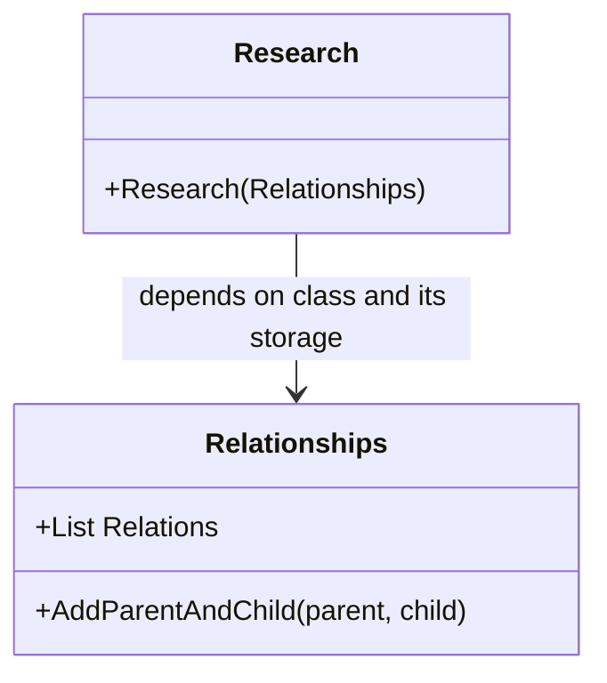
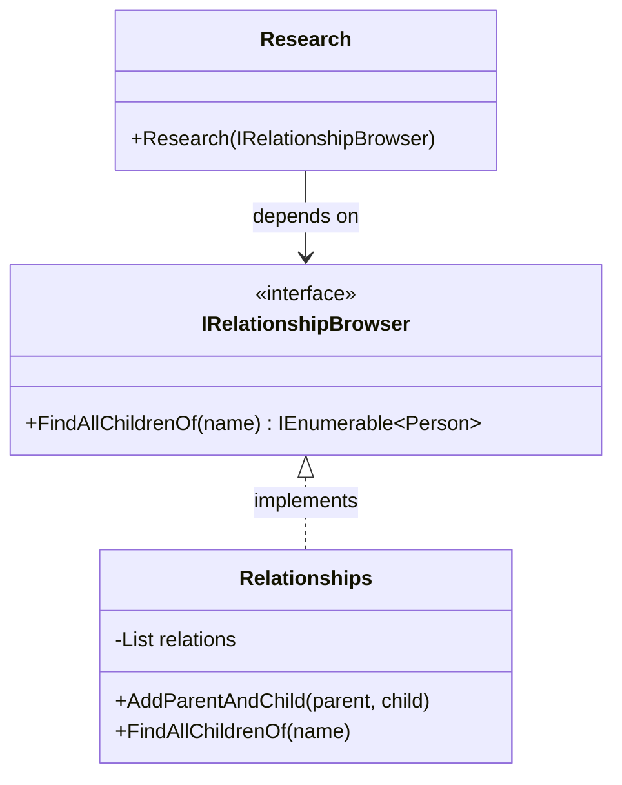

# Dependency Inversion Principle (DIP)

> "High-level modules should not depend on low-level modules. Both should depend on abstractions.
> Abstractions should not depend on details. Details should depend on abstractions."
> — Robert C. Martin

## What it means

- **High-level modules** hold the important logic (here, `Research` analyzing family relationships).
- **Low-level modules** are details of how things are done (here, `Relationships` storing data in a list).

Normally the high-level code calls the low-level code directly, so it depends on it. DIP **inverts** that:
the high-level code depends on an abstraction of what it needs, and the low-level code implements that
abstraction. Both point at the abstraction instead of at each other.

## Why it matters

- **Swappable details:** change how relationships are stored (list, dictionary, database) without touching
  `Research`.
- **Testable:** `Research` can be tested with a fake browser.
- **Encapsulation:** the low-level module can keep its storage private.

## The example

Finding all of John's children from a set of family relationships.

### Violation: [`DependencyInversionViolation.cs`](DependencyInversionViolation.cs)

`Relationships` exposes its internal list of `(Person, Relationship, Person)` tuples, and `Research` loops
over it directly. `Research` now depends on a concrete class **and** on how that class stores data. If
`Relationships` switches to a dictionary or a database, `Research` breaks.

### Following: [`DependencyInversionPrinciple.cs`](DependencyInversionPrinciple.cs)

| Type | Role |
|---|---|
| `IRelationshipBrowser` | The abstraction: `FindAllChildrenOf(name)` |
| `Relationships` | Low-level: implements the browser; keeps its list **private** |
| `Research` | High-level: receives an `IRelationshipBrowser`; never sees the storage |

The arrow from the low-level module now points **up** to the abstraction: that's the inversion. The
"find children" logic moved into `Relationships`, next to the data it reads.

## How to spot a violation

- High-level code uses `new` to create infrastructure classes (`new SqlConnection()`, `new HttpClient()`).
- High-level code reaches into another class's internal collections or fields.
- A class can't be unit tested without a real database, network, or file system.

## Common pitfalls

- **DIP is not the same as dependency injection.** Injection (passing dependencies in through the
  constructor, as `Research` does) is a technique that helps apply DIP; DIP is about which way the
  dependency points.
- **The abstraction belongs to the high-level side.** `IRelationshipBrowser` describes what `Research`
  needs, not everything `Relationships` can do.
- **Don't abstract everything.** Stable things like `string` or `List<T>` don't need an interface.
