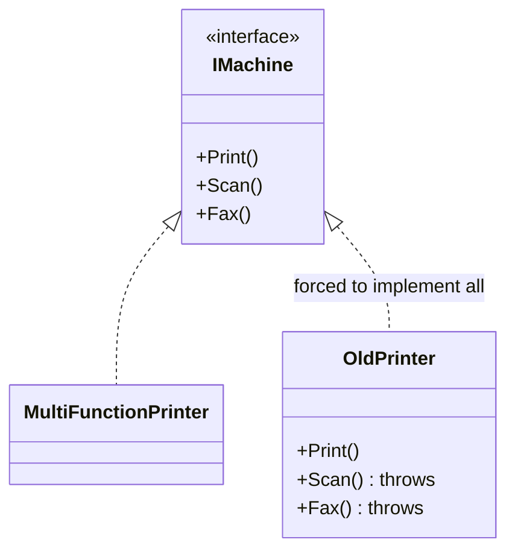
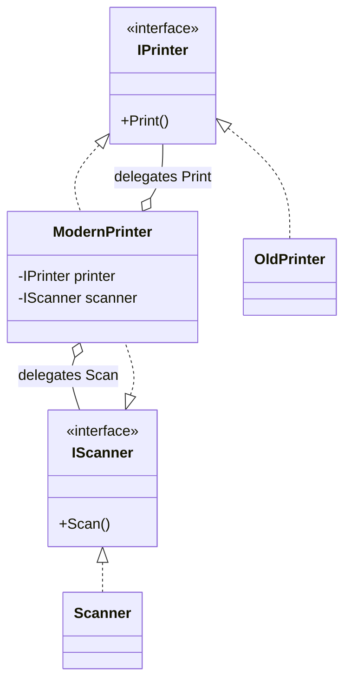

# Interface Segregation Principle (ISP)

> "Clients should not be forced to depend upon interfaces that they do not use."
> — Robert C. Martin

## What it means

Interfaces should be **small, specific, and well defined**, so that nobody who implements an interface has
to implement functions they don't actually need. Several focused interfaces are better than one large,
bloated ("fat") interface.

A class picks exactly the capabilities it has, and a client asks for exactly the capabilities it uses.

## Why it matters

- **No fake implementations:** classes don't end up with methods that throw or do nothing.
- **Errors move to compile time:** if a device can't scan, it isn't an `IScanner`, so the compiler stops
  you from asking it to scan.
- **Smaller ripple effect:** changing the scanning interface doesn't affect classes that only print.

## The example

The classic printer/scanner example.

### Violation: [`InterfaceSegregationViolation.cs`](InterfaceSegregationViolation.cs)

| Type | Role |
|---|---|
| `IMachine` | One fat interface: `Print`, `Scan`, and `Fax` |
| `MultiFunctionPrinter` | Can really do all three, so it's fine |
| `OldPrinter` | Can only print, but is forced to implement `Scan` and `Fax`, so they throw |

`IMachine` claims every device can scan, so the compiler lets you call `Scan` on an `OldPrinter`. The
mistake only shows up at runtime. This also breaks the
[Liskov Substitution Principle](../LiskovSubstitution/README.md): `OldPrinter` can't be used everywhere an
`IMachine` is expected.

### Following: [`InterfaceSegregationPrinciple.cs`](InterfaceSegregationPrinciple.cs)

| Type | Role |
|---|---|
| `IPrinter`, `IScanner` | One small interface per capability |
| `OldPrinter` | Implements only `IPrinter` |
| `Scanner` | Implements only `IScanner` |
| `ModernPrinter` | Implements both by **composing** an `IPrinter` and an `IScanner` and delegating to them |

Each device implements only what it can do. `ModernPrinter` reuses existing devices instead of
re-implementing them.

**About the pattern name:** `ModernPrinter` is **composition with delegation**, not the Decorator pattern.
A decorator wraps an object of the *same* interface to add behavior to it (see
[`09_Decorator`](../../09_Decorator/)). `ModernPrinter` combines two *different* objects behind two
interfaces.

## How to spot a violation

- Implementations that throw `NotImplementedException` / `NotSupportedException`, or have empty bodies.
- An interface with many methods where most implementers only use a few.
- Clients that receive an interface but only ever call one or two of its methods.

## Common pitfall

Don't split interfaces down to one method each by reflex. Group methods that are **used together by the
same clients**. The goal is interfaces shaped around what clients need, not the smallest possible
interfaces.
