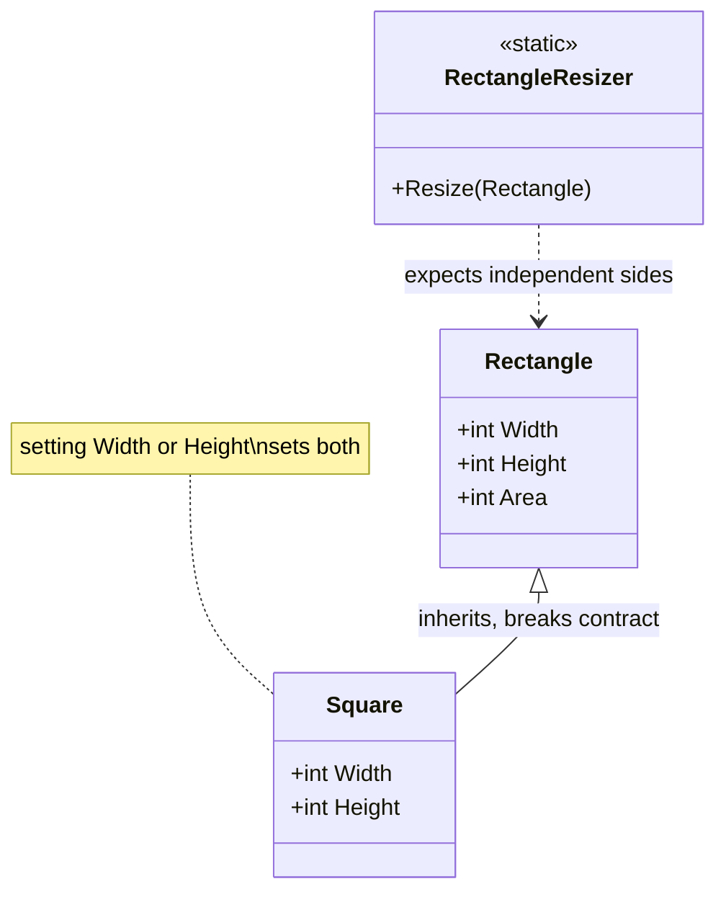
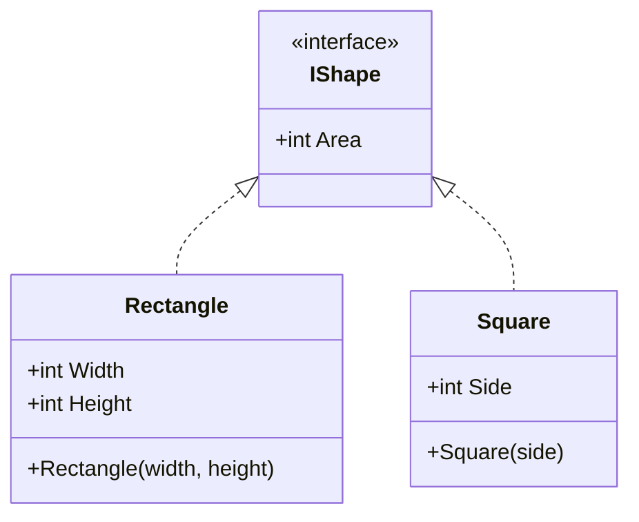

# Liskov Substitution Principle (LSP)

> "Subtypes must be substitutable for their base types."
> — Robert C. Martin's wording of Barbara Liskov's principle (1987)

## What it means

A derived class must be usable anywhere its base class is expected **without changing the program's
behavior**. Code written against the base class should keep working, unchanged and correct, when it
receives any subclass.

Inheritance is about **behavior**, not just an "is a" relationship. A subclass must honor the base class's
contract:

- It must not demand more from callers (stronger preconditions).
- It must not deliver less than promised (weaker postconditions).
- It must keep the base class's rules true (invariants), e.g. "setting `Width` doesn't change `Height`".
- It must not throw exceptions the base class wouldn't throw.

## Why it matters

- Polymorphism only works if every subclass can be trusted to behave like its base.
- Violations show up as subtle bugs far away from the subclass, in code that only knows the base type.
- Without LSP, callers end up with `if (x is Square)` checks, which also break the open/closed principle.

## The example

The classic rectangle/square problem.

### Violation: [`LiskovSubstitutionViolation.cs`](LiskovSubstitutionViolation.cs)

| Type | Role |
|---|---|
| `Rectangle` | Settable `Width` and `Height`. Implicit contract: they change independently. |
| `Square` | Inherits `Rectangle`; setting either side sets both |
| `RectangleResizer` | Client code: sets `Width = 5`, `Height = 4`, expects an area of 20 |

Mathematically a square *is a* rectangle, but behaviorally it isn't. Given a `Square`, the resizer gets an
area of 16 instead of 20. The resizer did nothing wrong; the subclass broke the base class's promise.

### Following: [`LiskovSubstitutionPrinciple.cs`](LiskovSubstitutionPrinciple.cs)

| Type | Role |
|---|---|
| `IShape` | The shared contract: only `Area`, which every shape can honor |
| `Rectangle` | Width and height set once through the constructor |
| `Square` | A single `Side`; no longer inherits from `Rectangle` |

The fix is to stop forcing `Square` into `Rectangle`'s contract. Both implement a smaller abstraction that
promises only what both can deliver. Making the shapes immutable also removes the "set width, then height"
scenario that caused the bug.

## How to spot a violation

- A subclass overrides a method to throw `NotImplementedException` or `NotSupportedException`.
- A subclass overrides a method to do nothing, or to do something the base class never would.
- Callers check the concrete type (`if (shape is Square)`) before using an object.
- A test written for the base class fails when run against a subclass.

## Common pitfall

Don't model inheritance on real-world "is a" wording alone. Ask instead: "can the subclass do
**everything** the base class promises, in the same way?" If not, prefer a shared interface or
composition over inheritance.
