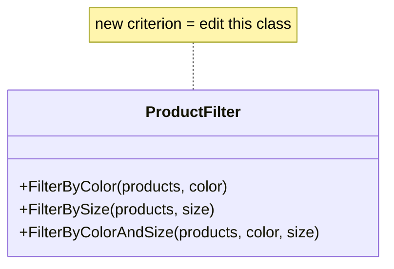
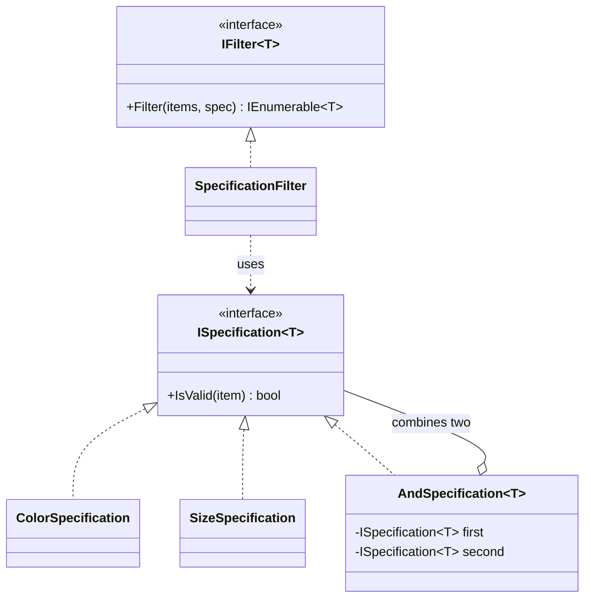

# Open/Closed Principle (OCP)

> "Software entities (classes, modules, functions, etc.) should be open for extension but closed for
> modification."
> — Bertrand Meyer

## What it means

- **Open for extension:** you can add new behavior to the system.
- **Closed for modification:** you add it **without editing** existing, already-tested code.

In practice: when you need a new feature, you write a **new class** instead of modifying an existing one.
This works when existing code depends on an abstraction and new behavior is added as a new implementation.

## Why it matters

- Adding a feature doesn't risk breaking features that already work.
- Existing code doesn't need to be re-tested every time something new is added.
- New behavior can be developed in isolation, in a new file.

## The example

Filtering a list of products by color, size, or both.

### Violation: [`OpenClosedViolation.cs`](OpenClosedViolation.cs)

Every new criterion means **modifying** `ProductFilter` and adding a method. Combinations grow quickly:
adding "weight" would need `FilterByWeight`, `FilterByColorAndWeight`, `FilterBySizeAndWeight`, and so on.

### Following: [`OpenClosedPrinciple.cs`](OpenClosedPrinciple.cs) (Specification pattern)

| Type | Role |
|---|---|
| `ISpecification<T>` | One criterion: `IsValid(item)` |
| `ColorSpecification`, `SizeSpecification` | Concrete criteria |
| `AndSpecification<T>` | Combines two specifications, so combinations need no new classes |
| `IFilter<T>` / `SpecificationFilter` | Filters any items with any specification; never changes |

To filter by weight, add a `WeightSpecification` class. `SpecificationFilter` stays untouched, and
`AndSpecification` already lets you combine it with color or size.

## How to spot a violation

- Long `if`/`else` or `switch` chains on a "type" value.
- A family of near-identical methods (`FilterByX`, `FilterByY`, `FilterByXAndY`).
- Adding a feature always means editing the same central class.

## Common pitfall

Don't add abstractions for everything "just in case". Introduce them where variation actually happens or
is clearly expected. Here, filter criteria are a known point of change.
