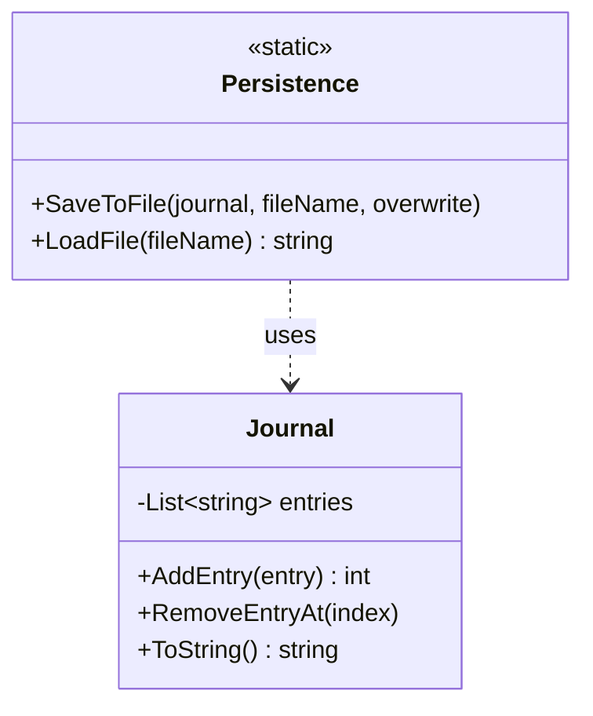

# Single Responsibility Principle (SRP)

> "A class should have only one reason to change."
> — Robert C. Martin

## What it means

A class should have **one job, one responsibility, one purpose**. A "reason to change" usually maps to a
single concern (business rules, persistence, formatting, notifications, ...). If two unrelated requests
could both force you to edit the same class, it has too many responsibilities.

A by-product of SRP is **separation of concerns**: each concern lives in its own place.

## Why it matters

- **Smaller blast radius:** changing how journals are saved can't break how entries are managed.
- **Easier to test:** each class can be tested in isolation.
- **Easier to read and reuse:** a focused class has a clear name and a clear purpose.

## The example

### Violation (not in code)

The tempting design puts saving and loading inside `Journal` itself:

```csharp
public class Journal
{
    public int AddEntry(string entry) { /* ... */ }
    public void RemoveEntryAt(int index) { /* ... */ }

    public void Save(string fileName) { /* ... */ }   // persistence concern
    public void Load(string fileName) { /* ... */ }   // persistence concern
}
```

Now `Journal` changes when the entry rules change **and** when the storage changes (file → database →
cloud). And every other class that needs saving would grow its own copy of the same logic.

### Following: [`SingleResponsibilityPrinciple.cs`](SingleResponsibilityPrinciple.cs)

| Class | Responsibility |
|---|---|
| `Journal` | Keeps the entries: add, remove, display |
| `Persistence` | Saves and loads journals to and from files |



`Journal` knows nothing about files. Changing the storage only touches `Persistence`.

## How to spot a violation

- The class name contains "And", "Manager", or "Service" and does a bit of everything.
- You describe the class with "it does X **and** Y **and** Z".
- Unrelated changes keep landing in the same file.

## Common pitfall

SRP doesn't mean "one method per class". Splitting too finely scatters logic that belongs together.
Group things that change for the **same** reason; separate things that change for **different** reasons.
