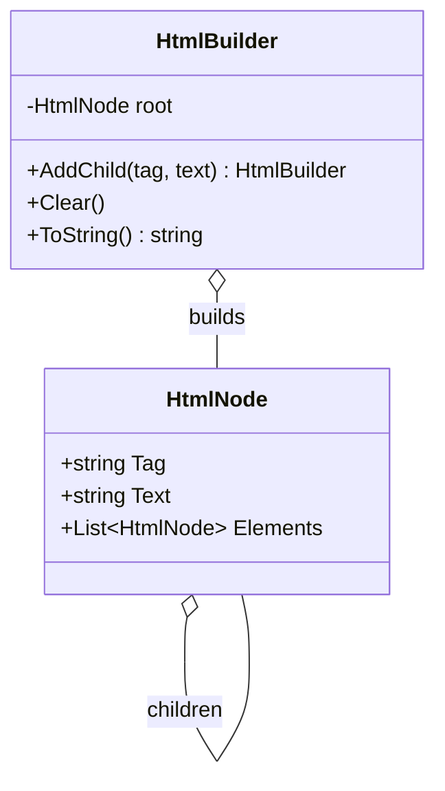
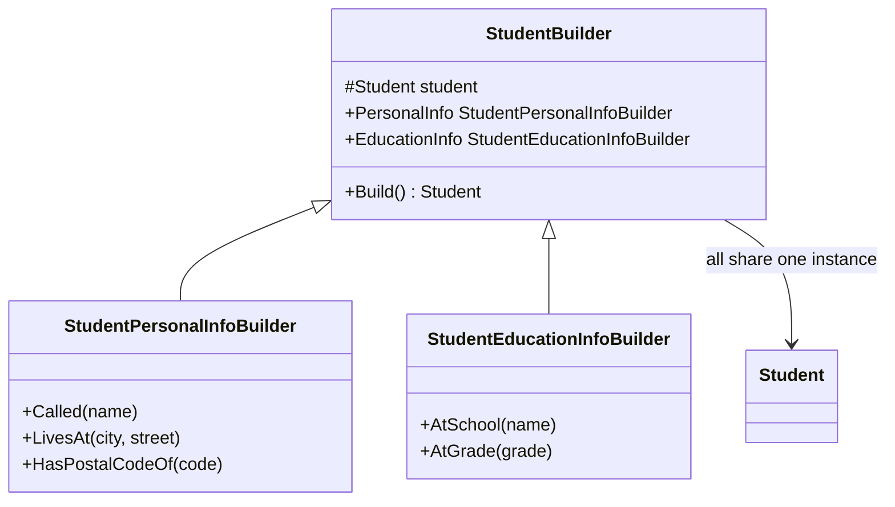
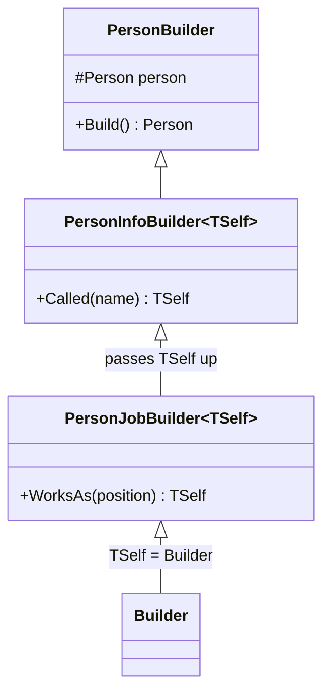
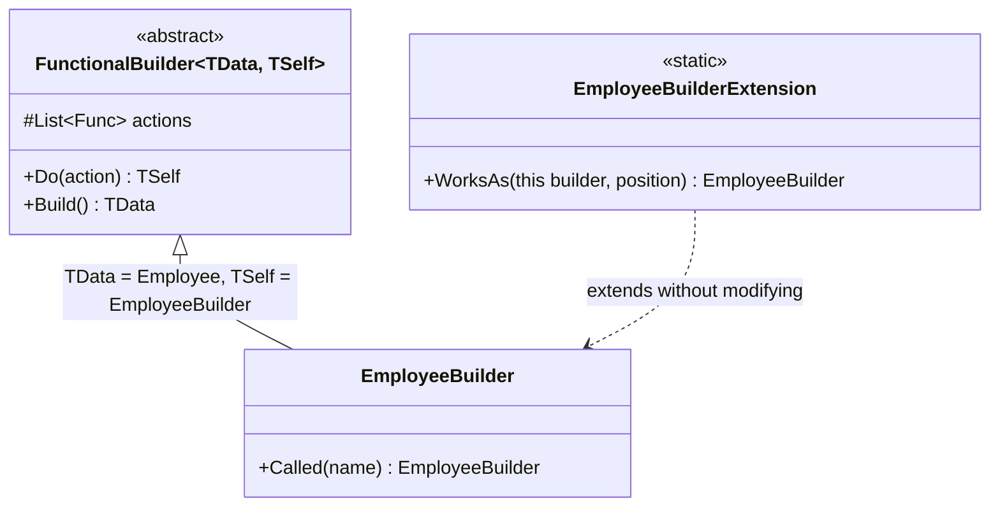

# Builder

> When piecewise object construction is complicated, provide an API for doing it succinctly.

**Category:** Creational pattern
**Built-in example:** `StringBuilder`

## What it means

Some objects are built in several steps: a tree of HTML elements, a person with a name and a job, a student
with personal and education details. Instead of one huge constructor, or setting many properties by hand,
a **builder** is a separate object whose only job is to construct the target step by step.

## Why it matters

- **Readable construction:** `.Called("Ahmed").WorksAs("Dev")` reads like a sentence; a 10-argument
  constructor doesn't.
- **Separation of concerns:** the object holds data; the builder holds the building logic (see the
  [Single Responsibility Principle](../01_Solid/SingleResponsibility/README.md)).
- **Flexible:** steps can be optional, repeated, or in any order.

All four variations below build on the first one. Each adds **one** extra idea.

| Variation | Problem it solves | Key trick |
|---|---|---|
| [Fluent](#1-fluent-builder) | Building step by step, readably | `return this;` |
| [Faceted](#2-faceted-builder) | One object with many groups of properties | Several sub-builders sharing one object |
| [Recursive generics](#3-recursive-generics) | Chaining breaks when builders inherit from each other | The base class returns `TSelf`, a type its child gives it |
| [Functional](#4-functional-builder) | Adding build steps without editing the builder | Store steps as functions, run them in `Build()` |

---

## 1. Fluent builder

[`FluentBuilder.cs`](FluentBuilder.cs): builds a two-level HTML tree (`<ul>` with `<li>` children).

```csharp
public HtmlBuilder AddChild(string childTagName, string childText)
{
    root.Elements.Add(new HtmlNode(childTagName, childText));
    return this;            // ← the whole trick
}

builder.AddChild("li", "hello").AddChild("li", "world");
```

Each method modifies the object being built and **returns the builder itself**, so calls chain. This is a
*fluent interface*. Every other variation is built on it.



---

## 2. Faceted builder

[`FacetedBuilder.cs`](FacetedBuilder.cs)

**Problem:** `Student` has groups of properties: personal info (name, address) and education info (school,
grade). One builder with every method gets big and messy.

**Idea:** one sub-builder per group ("facet"), all filling the **same** object, reachable from one entry
point.



Three ideas make it work:

1. **Every sub-builder shares the same `Student`.** `PersonalInfo => new(student)` passes the builder's own
   student along. `Student` is a class (reference type), so it's the same object, not a copy.
2. **Sub-builders inherit from `StudentBuilder`.** So inside the personal facet you still have
   `.EducationInfo` and `.Build()`, which lets you jump between facets mid-chain.
3. **Each facet method returns its own sub-builder**: plain fluent builder.

```csharp
new StudentBuilder()          // StudentBuilder: creates the Student
  .PersonalInfo               // → personal sub-builder (same student)
    .Called("Ahmed")
    .LivesAt("Cairo", "Saladin")
    .HasPostalCodeOf("1234566")
  .EducationInfo              // inherited property → education sub-builder (same student)
    .AtSchool("Benha")
    .AtGrade(4)
  .Build();                   // inherited: returns the one shared student
```

`StudentBuilder` acts as a **facade**: one simple entry point hiding several builders behind it (see
[`10_Facade`](../10_Facade/)).

---

## 3. Recursive generics

[`RecursiveGenerics.cs`](RecursiveGenerics.cs)

**Problem: fluent chaining breaks with inheritance.** Split the person builder into two classes the normal
way:

```csharp
class PersonInfoBuilder : PersonBuilder
{
    public PersonInfoBuilder Called(string name) { person.Name = name; return this; }
}
class PersonJobBuilder : PersonInfoBuilder
{
    public PersonJobBuilder WorksAs(string job) { person.Position = job; return this; }
}

new PersonJobBuilder().Called("Ahmed").WorksAs("Dev");   // ❌ compile error
```

`Called` is declared to return `PersonInfoBuilder`. After `.Called(...)` the compiler only sees a
`PersonInfoBuilder`, which has no `WorksAs`, even though the object really is a `PersonJobBuilder`.

**Fix:** the base class can't know who will inherit from it, so the child **tells it** through a generic
parameter:

```csharp
public class PersonInfoBuilder<TSelf> : PersonBuilder
    where TSelf : PersonInfoBuilder<TSelf>
{
    public TSelf Called(string name)
    {
        person.Name = name;
        return (TSelf)this;      // "return this, typed as whatever my child told me"
    }
}
```

- **`<TSelf>`**: "the type I should return from my methods."
- **`where TSelf : PersonInfoBuilder<TSelf>`**: "and it must itself be one of these builders." The class
  refers to itself in its own constraint; that's the *recursive* part. It also makes `(TSelf)this` safe.

Each level passes `TSelf` straight up, and an empty `Builder` class closes the loop:



Because `TSelf` is `Builder` at every level, **every** method returns `Builder`, so methods from any level
chain in any order:

```csharp
new Builder().Called("Ahmed").WorksAs("Dev").Build();
new Builder().WorksAs("Dev").Called("Ahmed").Build();   // also fine
```

> **Pass `TSelf` up, not `PersonJobBuilder<TSelf>`.** A common version writes
> `PersonJobBuilder<T> : PersonInfoBuilder<PersonJobBuilder<T>>`. With two levels it looks the same, but
> `Called` then returns `PersonJobBuilder<...>` instead of `Builder`. Add a third level (say `Born(year)`)
> and `Called(...).Born(...)` no longer compiles: methods only chain in level order.

---

## 4. Functional builder

[`FunctionalBuilder.cs`](FunctionalBuilder.cs)

**Idea:** don't build immediately. Record each step as a **function**, then run them all in `Build()`,
like writing a recipe instead of cooking.

```csharp
new EmployeeBuilder()
    .Called("Ahmed")     // adds "set Name" to the list; nothing happens yet
    .WorksAs("Dev")      // adds "set Position" to the list
    .Build();            // creates the Employee and runs every step in order
```



**Piece by piece:**

| Code | Meaning |
|---|---|
| `List<Func<TData, TData>> actions` | The recipe: functions that each take the object and return it |
| `Do(Action<TData> action)` | The one general method. `Called` is just `Do(e => e.Name = name)` |
| `actions.Add(p => { action(p); return p; })` | Wraps an `Action` (returns nothing) in a `Func` (returns the object) so steps can be chained in `Build` |
| `actions.Aggregate(new TData(), (e, f) => f(e))` | Start with a blank object, pass it through every step, return the result |
| `where TData : new()` | Required so `new TData()` is allowed |
| `TSelf` | Same trick as [recursive generics](#3-recursive-generics): `Do` returns `EmployeeBuilder`, so chaining works |

`Aggregate` is just this loop:

```csharp
var e = new TData();
foreach (var f in actions)
    e = f(e);
return e;
```

**Why bother?** Look at `WorksAs`: it isn't in `EmployeeBuilder` at all. It's an **extension method** in a
separate static class, and it works because `Do` is public. You add new building steps **without modifying
the builder and without inheritance**: the
[Open/Closed Principle](../01_Solid/OpenClosed/README.md).

---

## How to spot when you need a builder

- A constructor with many parameters, especially several of the same type (`string, string, string`).
- Many optional parameters, or several constructor overloads.
- Object setup spread over many lines of property assignments.
- The object must be assembled in steps (trees, documents, queries).

## Common pitfalls

- **Don't use a builder for simple objects.** Two or three required properties are fine in a constructor or
  an object initializer.
- **These builders return the same instance every time.** Calling `Build()` twice on the fluent, faceted,
  or recursive-generics builder returns the *same* object, so later changes affect earlier results. The
  functional builder is different: each `Build()` creates a new object.
