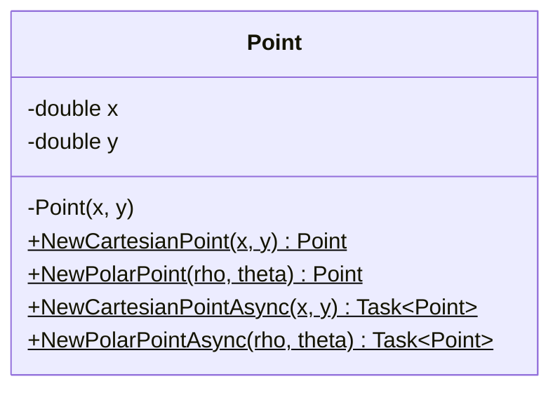
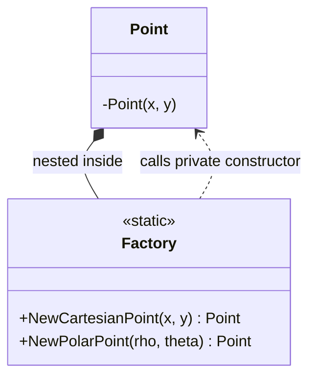
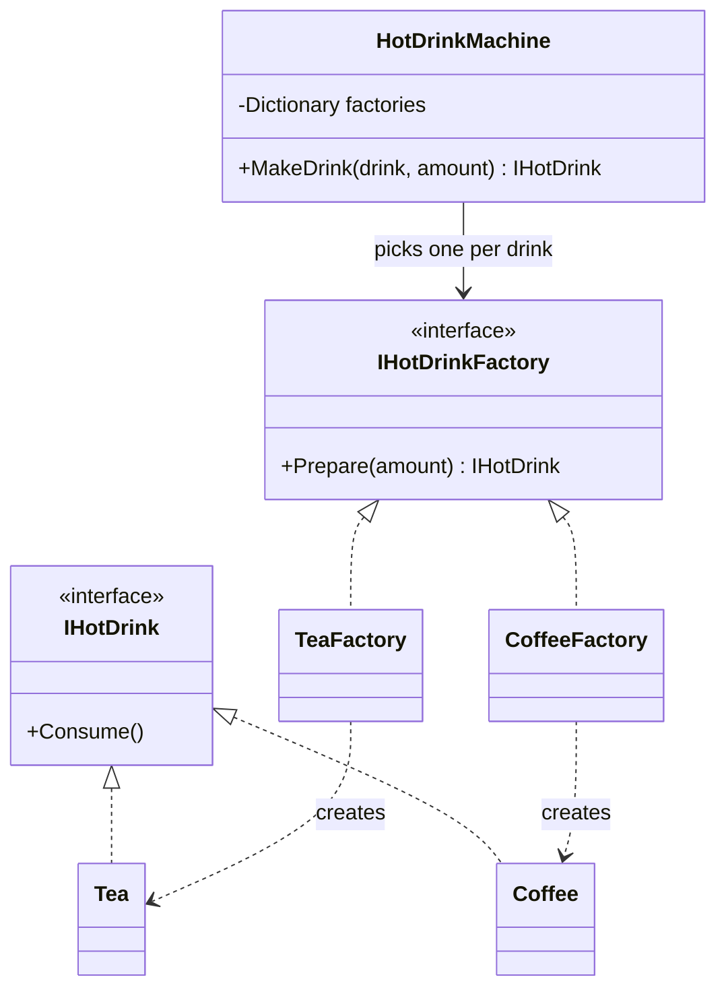

# Factories

> A component responsible solely for the **wholesale** (not piecewise) creation of objects.

**Category:** Creational pattern

## What it means

A **builder** creates an object step by step (see [`02_Builder`](../02_Builder/README.md)). A **factory**
creates it in one call, but gives you something a constructor can't:

- **A descriptive name.** `Point.NewPolarPoint(5, θ)` says what the numbers mean; `new Point(5, θ)` doesn't.
- **Different ways to build with the same parameter types.** Two constructors can't both take
  `(double, double)`.
- **Async creation.** Constructors can't be `async`; a factory method can.
- **Hidden concrete types.** The caller asks for an `IHotDrink` and never sees `Tea` or `Coffee`.

This project shows three forms, from simplest to most flexible:

| Form | Where | Key idea |
|---|---|---|
| [Factory method](#1-factory-method) | `Point.NewCartesianPoint(...)` | A static method replaces the constructor |
| [Factory class](#2-factory-class) | `Point.Factory.NewPolarPoint(...)` | Creation moves into its own class |
| [Abstract factory](#3-abstract-factory) | `IHotDrinkFactory` | An interface for factories, so the factory itself can be swapped |

---

## 1. Factory method

[`FactoryMethod.cs`](FactoryMethod.cs)

**Problem:** a point can be described in two coordinate systems, and both use two doubles:

```csharp
public Point(double x, double y) { ... }           // cartesian
public Point(double rho, double theta) { ... }     // ❌ same signature: won't compile
```

The usual workaround (an extra `enum CoordinateSystem` parameter) is ugly, and the parameter names can't
change to match the meaning.

**Fix:** make the constructor `private` and expose named static methods instead.

```csharp
private Point(double x, double y) { ... }

public static Point NewCartesianPoint(double x, double y) => new Point(x, y);

public static Point NewPolarPoint(double rho, double theta)
    => new Point(rho * Math.Cos(theta), rho * Math.Sin(theta));
```



The `...Async` versions show the other benefit: initialization that needs `await` (loading data, calling an
API) can't go in a constructor, but it can go in a factory method.

> **Polar to cartesian:** `x = ρ·cos θ`, `y = ρ·sin θ`. So `NewPolarPoint(5, π/2)` is the point `(0, 5)`.

> **Naming note:** in the GoF book, *Factory Method* means a virtual method that subclasses override to
> decide which class to create. The static, named-constructor style used here is often called a
> **static factory method**. Both replace a direct `new`.

---

## 2. Factory class

Same file: the nested `Point.Factory` class.

**Idea:** if creation logic grows, move it out of `Point` into a dedicated class. `Point` holds the data;
the factory holds the creation logic (separation of concerns, see the
[Single Responsibility Principle](../01_Solid/SingleResponsibility/README.md)).

```csharp
var p = Point.Factory.NewPolarPoint(5, Math.PI / 2);
```



**Why nested?** A separate top-level `PointFactory` class couldn't call `Point`'s `private` constructor.
Making the constructor `internal` would hide it from other assemblies, but anyone in the same assembly could
still bypass the factory. A **nested** class can access its outer class's private members, so the
constructor stays private and the factory still works.

> `Point` currently has both styles (static methods on `Point` *and* `Point.Factory`) for learning. In real
> code, pick one.

---

## 3. Abstract factory

[`AbstractFactory.cs`](AbstractFactory.cs)

**Problem:** a drink machine makes tea and coffee. Each drink has its own preparation steps. The caller
should just ask for a drink, without knowing the concrete classes.

**Idea:** put an **interface in front of the factories**, not just the products. Each drink gets its own
factory; the machine picks one at runtime.



**How the pieces fit:**

| Type | Role |
|---|---|
| `IHotDrink` | What the caller gets back (public) |
| `Tea`, `Coffee` | Concrete drinks (`internal`: callers never see them) |
| `IHotDrinkFactory` | The abstract factory: "something that can prepare a hot drink" |
| `TeaFactory`, `CoffeeFactory` | Concrete factories (`internal`) with their own preparation steps |
| `HotDrinkMachine` | Maps each `AvailableDrinks` value to its factory and delegates to it |

```csharp
var machine = new HotDrinkMachine();
IHotDrink drink = machine.MakeDrink(HotDrinkMachine.AvailableDrinks.Coffee, 200);
drink.Consume();
```

**How the machine finds the factories:** by **naming convention and reflection**. For each enum value `X`,
it looks up a class named `XFactory` in the same namespace and creates it with `Activator.CreateInstance`.
Adding a drink means adding an enum value and a matching factory class; the machine itself doesn't change.

The trade-off: the convention is checked at **runtime**, not compile time. Rename `TeaFactory` and the
code still compiles, but the machine throws when it starts. The explicit alternative is compile-checked:

```csharp
private readonly Dictionary<AvailableDrinks, IHotDrinkFactory> factories = new()
{
    [AvailableDrinks.Tea] = new TeaFactory(),
    [AvailableDrinks.Coffee] = new CoffeeFactory(),
};
```

> **Naming note:** in the GoF book, an *Abstract Factory* creates **families** of related objects, e.g. an
> `IHotDrinkFactory` with `CreateDrink()` *and* `CreateCup()`, where `TeaFactory` returns a tea and a teacup.
> This example has one product per factory, a simplified version that shows the core idea: callers depend
> on a factory interface, not on concrete classes.

---

## How to spot when you need a factory

- Constructor overloads that are hard to tell apart, or would clash on parameter types.
- Callers passing flags or enums to a constructor to choose how it behaves.
- Object creation that needs `await`.
- Callers that need an interface but currently `new` up concrete classes, tying them to implementations.

## Common pitfalls

- **Don't wrap every constructor in a factory.** If `new Thing(a, b)` is clear, keep it.
- **Abstract factories add a layer.** Use them when the concrete type really needs to be chosen at runtime
  or hidden from callers; otherwise a plain factory method is enough.
- **Reflection-based registration fails at runtime**, not compile time. Prefer explicit registration (or a
  dependency injection container) unless you really need automatic discovery.
