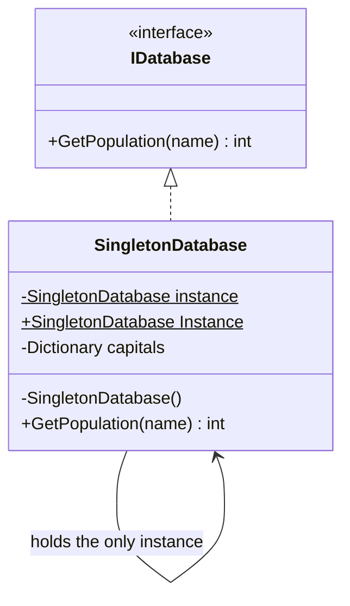
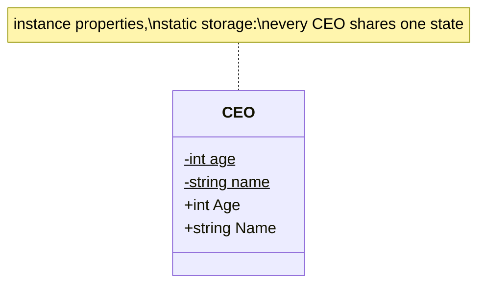
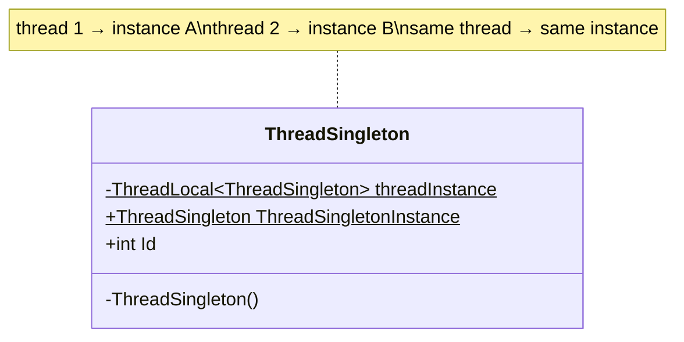

# Singleton

> A component which is instantiated only once.

**Category:** Creational pattern

## What it means

Some things should exist exactly once in a running application: a configuration store, a cache, a
connection to an expensive resource. A **singleton** guarantees there's only one instance and gives
everyone access to it.

> Your `EntryPoint.cs` says "per app domain". That was true in .NET Framework. Modern .NET has a single
> app domain, so in practice a static singleton means **one instance per process**.

This project shows three variations:

| Variation | Where | Key idea |
|---|---|---|
| [Classic singleton](#1-classic-singleton) | `SingletonImplementation.cs` | Private constructor + one static instance |
| [Monostate](#2-monostate) | `Monostate.cs` | Many instances, but all share the same static state |
| [Per-thread singleton](#3-per-thread-singleton) | `PerThreadSingleton.cs` | One instance per thread instead of per process |

---

## 1. Classic singleton

[`SingletonImplementation.cs`](SingletonImplementation.cs): a database of capital-city populations that
should only be loaded once.

```csharp
internal class SingletonDatabase : IDatabase
{
    private static SingletonDatabase instance = new SingletonDatabase();
    public static SingletonDatabase Instance => instance;

    private SingletonDatabase() { /* load the data once */ }
}
```



Two pieces make it work:

1. **Private constructor:** nobody outside the class can call `new SingletonDatabase()`.
2. **Static field:** the one instance lives in a static field, and `Instance` hands it out. `db` and `db2`
   in the demo are the same object, and "Initializing Database..." prints only once.

**Thread safety:** the runtime guarantees a static field initializer runs **once**, even if several threads
touch the class at the same time. So this version is thread-safe without any locks.

**When is it created?** The comment in the code says "on the first call". That's *roughly* right, but
because the class has no static constructor, the runtime is allowed to initialize it earlier. If you need
guaranteed lazy creation (e.g. loading is expensive and may never be needed), use `Lazy<T>`:

```csharp
private static readonly Lazy<SingletonDatabase> instance = new(() => new SingletonDatabase());
public static SingletonDatabase Instance => instance.Value;   // created on first access, thread-safe
```

### The big problem: testability

Any code that calls `SingletonDatabase.Instance` directly is **hard-wired** to the real database:

```csharp
public int TotalPopulation(IEnumerable<string> cities)
    => cities.Sum(c => SingletonDatabase.Instance.GetPopulation(c));   // can't swap in test data
```

A unit test for this would read live data, and break whenever the data changes. The fix is the
[Dependency Inversion Principle](../01_Solid/DependencyInversion/README.md): depend on `IDatabase` (which
your code already has) and **receive** it instead of fetching it:

```csharp
public class PopulationCalculator(IDatabase database)
{
    public int TotalPopulation(IEnumerable<string> cities) => cities.Sum(c => database.GetPopulation(c));
}
```

In real applications the usual answer is to let a **dependency injection container** own the "only one"
rule, e.g. `services.AddSingleton<IDatabase, Database>()`. You get a single instance without a static
`Instance` property, and tests can pass in a fake.

---

## 2. Monostate

[`Monostate.cs`](Monostate.cs)

**Idea:** let callers use `new` as usual, but store all the data in **static** fields. Every instance reads
and writes the same values, so they all behave like one object.

```csharp
internal class CEO
{
    private static int age;
    private static string name = string.Empty;

    public int Age { get => age; set => age = value; }
    public string Name { get => name; set => name = value; }
}

var ceo1 = new CEO { Name = "Ahmed", Age = 25 };
var ceo2 = new CEO();
Console.WriteLine(ceo2.Name);   // "Ahmed": ceo2 sees ceo1's data
```



**Downside:** it's surprising. `new` normally means "a fresh, independent object", and here it doesn't.
Nothing in the calling code hints that the objects are linked. It's mostly useful when existing code
already does `new CEO()` everywhere and you need it to share state without changing the callers.

---

## 3. Per-thread singleton

[`PerThreadSingleton.cs`](PerThreadSingleton.cs)

**Idea:** sometimes you want one instance **per thread** rather than per process, e.g. a non-thread-safe
resource that each thread should have its own copy of.

```csharp
private static ThreadLocal<ThreadSingleton> threadInstance =
    new(() => new ThreadSingleton());

public static ThreadSingleton ThreadSingletonInstance => threadInstance.Value!;
```

`ThreadLocal<T>` keeps a separate value for each thread and runs the factory (`() => new ThreadSingleton()`)
the first time each thread asks.



In the demo, `t1` and `t2` get different instances (different threads), and `t2` prints the same ID twice
(same thread, same instance). The ID shown is the thread's ID, so the two threads normally print different
numbers. .NET can reuse a finished thread's ID, though, so in rare runs where `t1` ends before `t2` starts,
the numbers can match even though the instances are different.

> The demo uses `new Thread(...)` rather than `Task.Factory.StartNew(...)`. Tasks run on a shared pool of
> threads, so two tasks can end up on the **same** thread and would then correctly share one instance,
> which makes the demo look broken when it isn't.

---

## How to spot when you need a singleton

- An object is expensive to create (loads data, opens connections) and only one is ever needed.
- Several parts of the app must see the **same** state (a cache, a registry).
- Creating a second instance would be a bug (two config sources that could disagree).

## Common pitfalls

- **Hidden dependencies.** Code that calls `X.Instance` deep inside doesn't show in its constructor that it
  needs `X`. Prefer passing dependencies in.
- **Hard to test.** Tests can't swap a static singleton for a fake, and state leaks between tests.
- **Global mutable state.** A singleton with settable state is a global variable with extra steps.
- **Hand-rolled lazy initialization.** Writing your own `if (instance == null) instance = new ...` is
  not thread-safe. Use a static initializer or `Lazy<T>`.
- **Prefer a DI container's singleton lifetime** over a static `Instance` in application code.
